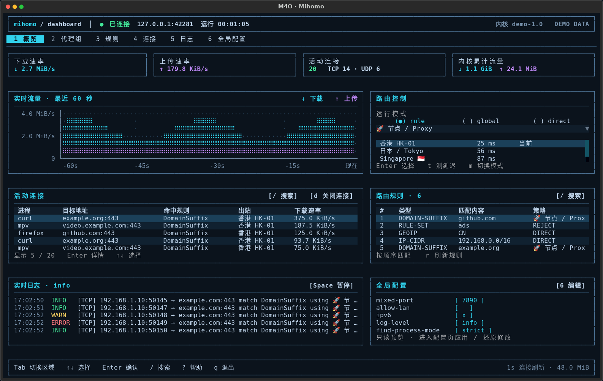

# M4O · Mihomo Terminal Dashboard

使用 **Python 3.11+ / Textual / aiohttp** 实现的 mihomo 终端 dashboard。
无需浏览器、额外后端或数据库，支持键盘和鼠标；可连接本机或远程 mihomo。

## 安装与启动

项目使用 **uv** 管理 Python、虚拟环境、依赖和构建。请先
[安装 uv](https://docs.astral.sh/uv/getting-started/installation/)（0.12.23 或更新版本）。

```bash
# 在本项目目录中，按 uv.lock 创建 / 同步 .venv（默认包含开发依赖）
uv sync --locked

# 不需要 mihomo，即可体验完整界面和模拟操作
uv run --locked m4o --demo

# 连接实际控制器；secret 为空时不必设置
export MIHOMO_URL=http://127.0.0.1:9090
# Bash 下隐藏输入，避免明文 secret 出现在 shell history / 进程参数中
read -rs -p 'Mihomo secret: ' MIHOMO_SECRET; echo
export MIHOMO_SECRET
uv run --locked m4o
```

无需手动创建或激活虚拟环境。`.python-version` 指定默认开发版本 Python 3.11，
缺少解释器时 uv 可自动下载，也可先执行 `uv python install`。
项目支持 Python 3.11+，CI 通过版本矩阵覆盖 3.11–3.14。
`uv run --locked m4o`、`uv run --locked mihomo-dashboard`、
`uv run --locked python -m m4o_dashboard` 是等价入口。
只运行程序、不安装开发工具时，使用 `uv sync --locked --no-dev`，
随后用 `uv run --locked --no-dev m4o` 启动。
需要交互式终端，最低建议 **80 × 24**。**160 × 49** 可完整显示概览与五个详情页面的多列面板；
120 × 36 可以滚动查看。少于 100 列时概览改为单列布局。
支持现代 Linux/macOS 终端与 Windows Terminal；实际兼容性取决于终端的键鼠报告能力。
鼠标不可用时，所有功能均可通过键盘完成。

## 界面



概览使用深色背景、蓝色细边框和青色选中态。下载为青色，上传为紫色。
四张指标卡下面是流量图、路由控制、连接、规则、日志和配置预览。
截图来自本地演示服务运行 60 秒后的实际界面；字号和 emoji 外观取决于终端字体。

五个详情页沿用深色、细边框、青色高亮的设计，支持窄屏滚动：

| 代理组 | 规则 | 连接 | 日志 | 全局配置 |
| --- | --- | --- | --- | --- |
| [截图](docs/images/proxies.png) | [截图](docs/images/rules.png) | [截图](docs/images/connections.png) | [截图](docs/images/logs.png) | [截图](docs/images/config.png) |

代理页展示候选节点和应用前的切换预览；规则、连接和日志页提供常驻详情栏。
配置页展示字段前后差异，黄色星号标记未应用的修改。

## 功能

- **概览**：实时上传/下载速率、最近 60 秒的趋势图、内核累计流量、连接数及 TCP/UDP 计数。
  显示当前页面、运行模式、配置来源和连接状态；可切换 rule/global/direct 模式及策略组节点。
- **代理**：策略组卡片、按延迟排序的节点表、UDP/可用状态、候选详情和切换预览。
  搜索组名或节点；Enter 应用、Esc 取消候选；`t` 测试整个组，保留自动组的固定节点。
  URLTest / Fallback 可固定节点及恢复自动；LoadBalance 不提供手选。测速是延迟探测。
- **规则**：按类型、策略、关键词组合筛选，保留原始序号和内核顺序；常驻详情与规则表达式。
  展示规则集状态、行为、格式、数量及更新时间；在规则集列表按 `r` 更新选中规则集。
  表达式由 API 字段重建，不包含 API 未返回的 YAML 选项；规则接口失败保留最后数据。
- **连接**：统计卡、网络/出站筛选、速率/累计量排序、常驻详情、命中规则与出站链路。
  展示所选连接最近 60 秒真实采样；`Space` 暂停/恢复本页刷新，后台继续接收。
  关闭单条或全部连接都需要确认；“关闭全部”包括当前筛选条件以外的连接。
- **日志**：有界缓存与级别统计、级别/关键词过滤、逐行选择、原文详情与剪贴板复制。
  导航或向上滚动暂停自动跟随，显示新增条数；`Space`/`End` 恢复，`Ctrl+L` 清空本地缓存。
  显示时间来源（内核提供或客户端接收），不把客户端时间标成内核事件时间。
- **全局配置**：分类导航、常规与入站端口编辑、逐项修改预览；后台刷新保留草稿。
  支持 `mode`、`allow-lan`、`ipv6`、`log-level`、`find-process-mode` 和五种代理端口。
  `Ctrl+Enter` 只应用修改过的运行字段；`Ctrl+S` 独立保存到显式关联的本地 YAML。
  DNS/TUN/嗅探分类展示控制器返回的只读配置；不支持的字段不假装可编辑。
- **网络**：Bearer 鉴权、HTTP 超时、独立 WebSocket 重连、指数退避、连接状态和断流提示。
- **演示**：`--demo` 启动进程内的 loopback 模拟服务，退出时清理；所有操作只修改模拟数据，
  不会访问真实 mihomo，也不会实际代理网络流量；保存配置仅在内存中模拟。

切换节点或模式通常只影响**新连接**，不会自动中断/迁移已有连接。
确认操作成功后读取内核状态，不假定写请求成功就一定能改变全部连接。

## 键盘与鼠标

| 按键 | 功能 |
| --- | --- |
| `1` / `2` / `3` / `4` / `5` / `6` | 概览 / 代理组 / 规则 / 连接 / 日志 / 全局配置 |
| `Tab` / `Shift+Tab` | 切换焦点 |
| `↑` / `↓` 或 `j` / `k` | 表格导航 |
| `Enter` | 打开组的节点列表 / 切换选中节点 / 查看连接详情 |
| `/` | 聚焦当前页面搜索框 |
| `Esc` | 离开搜索框、取消弹窗，或在全局配置页还原未提交的修改 |
| `r` | 刷新列表；规则集列表获得焦点时更新选中规则集 |
| `t` | 概览测试选中节点；代理页测试当前组所有候选节点 |
| `m` | 在概览或代理页依次切换 rule/global/direct 模式 |
| `Delete` / `d` | 在连接表格中关闭选中连接（需确认） |
| `Space` | 概览/日志页暂停或恢复日志滚动；连接页暂停或恢复刷新 |
| `Ctrl+Enter` | 在全局配置页应用到运行配置 |
| `Ctrl+S` | 在全局配置页保存到关联的本地 YAML |
| `y` / `l` / `Ctrl+L` | 日志页复制原文 / 选择级别 / 清空本地缓存 |
| `End` | 日志表格获得焦点时恢复跟随最新日志 |
| `?` | 帮助 |
| `q` / `Ctrl+C` | 退出 |

点击标签页、表格、按钮均可操作，滚轮滚动。代理表格中点击已选中的行也会切换节点。
输入框内的普通字母/数字用于输入，不触发页面切换等快捷键。
较宽表格可横向滚动；中文、空格、emoji、`/` 等节点名会作为完整 URL 路径段编码。

## 配置

默认读取 `$XDG_CONFIG_HOME/m4o/config.toml`，未设置 XDG 时读取
`~/.config/m4o/config.toml`。也可以 `uv run --locked m4o --config ./config.local.toml`。
配置优先级：**命令行 > 环境变量 > TOML > 默认值**。可复制仓库中的 `config.example.toml`。

```toml
url = "http://127.0.0.1:9090"
# secret = ""  # 建议用 MIHOMO_SECRET；配置文件含 secret 时 chmod 600
verify_tls = true
# proxy = "http://localhost:9999"  # 只在访问控制器确实需要代理时设置

timeout = 10.0          # HTTP 超时，秒
interval = 1000         # /connections 推送间隔，毫秒；250–60000
refresh_interval = 5.0  # 配置/代理轮询间隔，秒
max_logs = 5000         # 最多保留的日志条目数
test_url = "https://www.gstatic.com/generate_204"
```

环境变量：`MIHOMO_URL`、`MIHOMO_SECRET`。全部命令行参数见 `uv run --locked m4o --help`。
`--interval` 只控制连接快照，`/traffic` 通常由内核每秒推送。

### 独立保存内核 YAML

```bash
uv run --locked m4o --kernel-config /absolute/path/to/daily.yaml
```

`--config` 仍然是 dashboard 的 TOML；`--kernel-config` 是可选的 mihomo YAML。
远程控制器不会暴露服务器文件路径，只有此电脑可访问的 YAML 才能关联。
保存只包含本次手动修改的字段，不将后台轮询更新混入文件。保留注释、其余字段和权限，
保存前在同目录生成唯一 `.bak` 备份，并通过临时文件原子替换；检测到外部修改时拒绝覆盖。
应用成功后仍可以单独保存；保存成功不会自动修改内核运行设置。未关联文件时禁用保存按钮。

### mihomo 侧

在 mihomo 配置中启用外部控制器，例如：

```yaml
external-controller: 127.0.0.1:9090
secret: "换成你自己的随机密钥"
```

无须配置 external-ui 或 CORS。Dashboard 默认只调用控制 API；显式指定 `--kernel-config` 后才读取本地 YAML。
远程推荐 SSH 隧道：

```bash
ssh -N -L 19090:127.0.0.1:9090 user@server
uv run --locked m4o --url http://127.0.0.1:19090
```

**不要将无鉴权控制端口直接暴露在公网。** 直连远程时使用受保护的 HTTPS。
HTTP 和 WebSocket 都通过 Authorization 请求头鉴权，不把 secret 放在 URL 中。
默认验证 TLS；`--insecure` 会显式禁用验证并在界面警告，仅用于排查问题。
HTTP 重定向不会自动跟随，应配置最终控制器 URL。

程序**默认不使用 `HTTP_PROXY` / `HTTPS_PROXY` 等环境代理**，避免本地控制器请求被转发。
需要时显式使用 `--proxy http://localhost:9999`。这不会改变节点延迟测试的路径：
测试请求由 mihomo 内核经指定节点发起。

## 数据与性能约定

- 不保存日志、历史流量或节点选择到本地数据库；节点选择是否跨内核重启保留取决于 mihomo。
- 兼容 `/traffic` 仅包含 up/down 的旧格式：累计流量也可由 `/connections` 获取；
  连接为空数组或 null 都视为无连接。日志兼容普通格式与 structured 格式。
- 流量图按样本时间戳绘制最近 60 秒，最多保留 180 个样本。启动时从右侧逐渐填充，
  不生成虚假历史数据。累计流量来自内核，不是本次界面运行的流量。
- 单连接速率通过相邻快照的字节差除以实际单调时钟间隔计算，重连后首个样本不计算速率。
- UI 最多每 250ms 批量刷新，隐藏页面不持续绘制。列表按稳定 ID 更新，尽量保持选中行与滚动位置。
- 日志暂停只暂停绘制，不暂停网络接收；超过上限时淘汰最旧条目。向上滚动会暂停追加绘制，
  按 Space/End 恢复。表格按有界缓存更新，多行日志在表格中折叠显示，可通过 Enter 展开原文。
- 连接异常时保留最后数据并明确显示断流状态，不能将残留数值理解为实时数据。
- 不依赖内核回应 WebSocket PONG：流量/连接流有接收超时，日志流允许正常空闲；
  HTTP 健康检查发现网络故障时也会重建日志流。关闭握手总时长限为 1 秒，避免退出挂起。
- DEBUG 筛选不会自动提高内核自身的 log-level；内核未产生的日志无法显示。
- 不支持此内核版本的写操作会展示 HTTP 错误，不会假装切换成功。

## 项目与依赖管理

- `pyproject.toml`：项目元数据、运行依赖，以及 `[dependency-groups].dev` 开发依赖组。
- `uv.lock`：精确依赖版本和哈希，纳入 Git；不要手动编辑。
- `.python-version`：默认开发用 Python 版本，纳入 Git。
- `.venv/`、缓存、`dist/`、`.env` 和本地配置由 `.gitignore` 排除。

```bash
uv add <package>             # 添加运行依赖，同时更新 pyproject.toml 和 uv.lock
uv add --dev <package>       # 添加开发依赖
uv remove <package>          # 删除运行依赖
uv remove --dev <package>    # 删除开发依赖
uv lock --upgrade-package textual  # 显式升级某个包的锁定版本
uv sync --locked            # 将环境同步到锁文件
uv lock --check             # 检查锁文件与项目配置一致
uv build                    # 构建 sdist 和 wheel，输出到 dist/
```

日常运行与 CI 使用 `--locked`，锁文件过期时直接报错而不是静默修改。
更改依赖后，将 `pyproject.toml` 与 `uv.lock` 一起提交；更改默认 Python 时使用
`uv python pin <version>` 并提交 `.python-version`。

## 开发与验证

```bash
uv sync --locked --group dev
uv run --locked ruff check .
uv run --locked ruff format --check .
uv run --locked pytest -q

# 对六个页面保存 SVG 截图，始终使用本地演示数据
env -u NO_COLOR uv run --locked python scripts/capture_ui.py --output screenshots --width 160 --height 49 --warmup 60
```

常规测试使用本地 aiohttp 模拟服务、Textual headless Pilot 和 POSIX 伪终端，不要求真实代理，
也不访问公网。另有可选的真实内核契约测试：

```bash
# PATH 中需有 mihomo；会启动隔离的临时内核，不读取或操作现有实例
M4O_TEST_MIHOMO=1 uv run --locked pytest -q
```

已在 Python 3.11、Textual 8.2.8、aiohttp 3.14.4、mihomo 1.19.32 的 Linux 环境验证。
CI 配置覆盖 Python 3.11–3.14；其他终端、tmux、Windows/macOS 的实际鼠标行为仍应在目标环境验收。

```text
src/m4o_dashboard/
  api.py          HTTP / WebSocket、鉴权、重连
  config.py       配置加载和校验
  models.py       数据归一化、速率计算、有界日志
  app.py          异步任务、共享状态、应用动作
  ui.py           表格同步、命令消息及弹窗
  proxies.py      策略组、候选详情和切换预览
  connections.py  连接筛选、详情和单连接流量
  logs.py         日志表格、筛选和详情
  kernel_config.py 配置草稿、分类和修改预览
  kernel_file.py  保留注释的 YAML 保存与备份
  charts.py       最近 60 秒终端流量图
  overview.py     概览面板、时间轴图表和路由控制
  panels.py       规则浏览、筛选、规则集详情与更新
  theme.py        共享配色
  dashboard.tcss  终端样式及窄屏布局
  demo.py         本地模拟 mihomo
  cli.py          命令行入口
```

接口依据：[mihomo 原始 API 文档](https://wiki.metacubex.one/en/api/)。
支持监控、代理控制、规则浏览和有限的内核运行配置修改。
支持显式关联本地 YAML 后保存已编辑的常规字段；不包含配置文件切换、代理订阅更新、规则编辑、内核升级。
